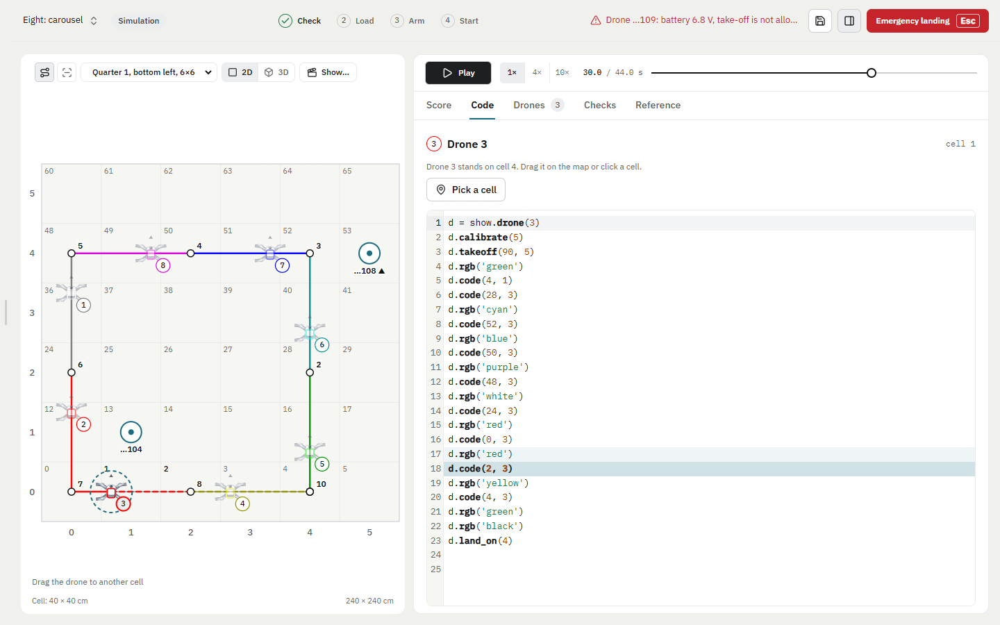
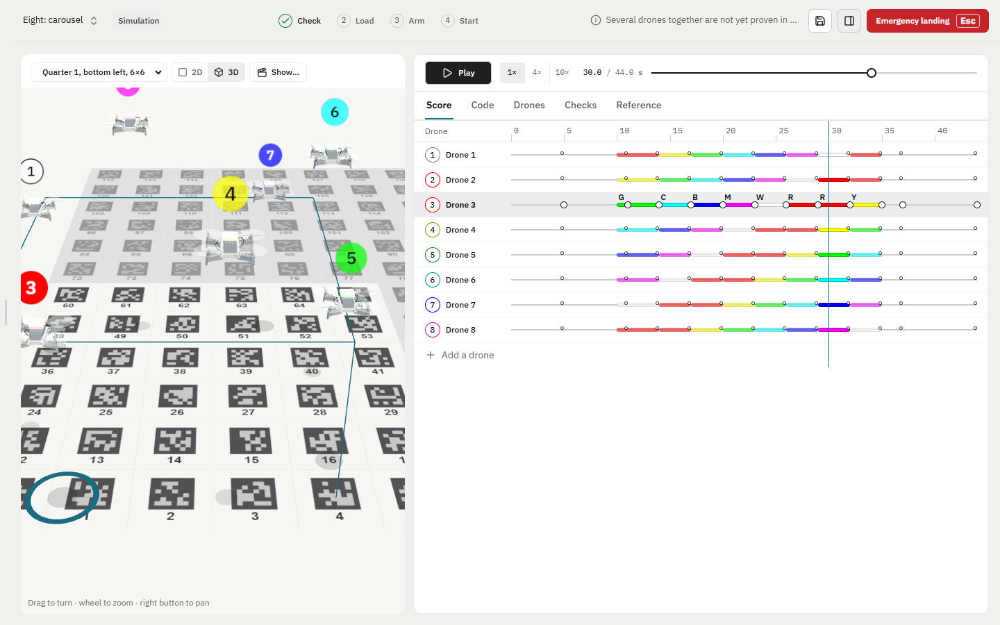
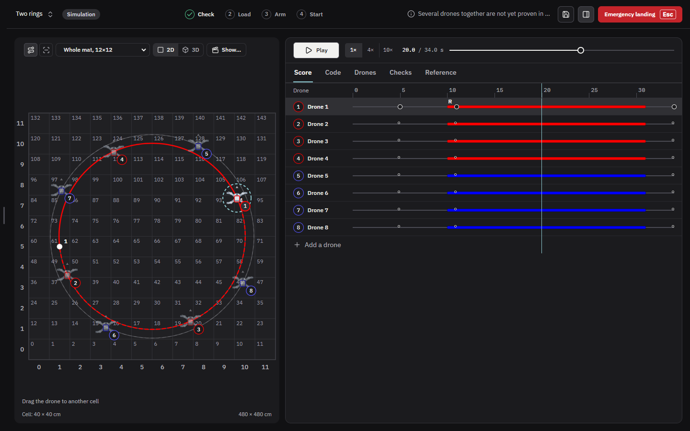

# Litebee IDE

**English** · [Русский](README.ru.md)

A desktop environment for programming and flying **LiteBee Wing** drones (Makerfire FM-10 kit). You write a show in Python, watch it on a map of the classroom mat, check it, load it into the drones and start it. It replaces the Scratch part of LiteBee Go and imports its `.lbg` projects.

Everything except the explicit link commands works without drones: write a show, watch the simulation, read the check report.



## What it does

- **Map of the mat.** 12 × 12 cells of 40 cm, top view. Cell number = column + 12 × row. The drones are drawn after the real LiteBee Wing. A whole mat or one quarter (6 × 6 cells, a classroom mat folded in four) can be shown.
- **2D and 3D.** The map can be switched to a 3D view: the 3D model of the LiteBee Wing flies over the mat, its LED lights in the colour of the show, the propellers turn in the air, and a tag with the number and the colour hangs over each drone. Drag to turn the camera.
- **One window.** The scene (a 2D or 3D map of the mat) takes two fifths on the left. The window on the right takes three fifths and has its tabs in one row: **Score** (one column per drone, time runs down, the light and the stations on each line), **Code**, **Drones**, **Checks**, **Reference**. The show time above the tabs is the same on every tab. Press a drone on the map and its own program opens in **Code**; the project is still one Python file inside, but every drone is shown and edited on its own. Drag a drone to another cell on the map (2D or 3D) to change where it starts.
- **Check.** Runs the show and reports errors, drones closer than 60 cm, height over the limit, speed over 100 cm/s and steps that cannot be loaded.
- **Link to real drones.** Battery and position of every drone, roles by the cell a drone stands on, an archive of known drones. Order of work: Check, Load, Arm, Start. Start asks for confirmation.
- **Emergency landing** is always visible (top right, key `Esc`).
- **Starting positions.** Every drone starts from a cell of its own. Drag a drone on the map to another cell, or press **Place a drone** and then a cell; the **+** button adds one more drone at any moment. Both change the code, so `Ctrl+Z` takes them back.
- **146 ready shows** for 2 to 10 drones, sorted by the number of drones, with a project wizard that filters them.
- **Russian and English** interface, light and dark theme.
- **Reference** of every show function with units, examples and the status “flown on a drone” or “simulator only” (`F1`).





## Running the app

Windows, Node.js 20 or newer.

```bash
cd desktop
npm install
npm run dev        # development
npm run build      # production build into desktop/out
npm test           # unit tests (they never touch real drones)
```

The show code runs in Python (Pyodide) inside the app, so no Python is needed to use it. The tests talk to a fake drone on `127.0.0.1`, never to the real ports 18001, 6000 and 13146.

## A show looks like this

```python
from litebee_show import Show

show = Show('Square in a quarter')

d = show.drone(1)
d.calibrate(5)
d.takeoff(100, 5)
d.rgb('green')
d.code(13, 1)    # the start cell
d.code(16, 4)    # fly to cell 16 in 4 seconds
d.rgb('black')
d.land()
```

Before loading, every drone stands on the cell of its first `d.code(...)`.

## Safety

- Nothing in the app makes a drone fly without an explicit action: loading does not spin the motors, Start asks for confirmation.
- Take off over a fresh battery (start is refused below 7.0 V).
- Position steps need the drone to know where it is: do a short take-off first, and do not carry the drone between loading and starting.
- Emergency landing: the red button or `Esc`.

## Repository

| Path | What is there |
| --- | --- |
| `desktop/` | the app: Electron, React, TypeScript, Pyodide |
| `litebee/`, `app/` | the Python engine (show model, protocol) and the earlier PySide6 app, kept as a reference |
| `shows/` | example shows, `shows/gallery/` the generated 146 |
| `tools/` | generators of the gallery, translation and reference exporters |
| `docs/` | protocol notes ([single drone](docs/PROTOCOL_SINGLE.md), [steps](docs/PROTOCOL_STEPS.md)), [design](docs/DESIGN.md), [manual notes](docs/WING_MANUAL_NOTES.md) |
| `docs/uchebnik/` | a textbook in Russian (LaTeX, [PDF](docs/uchebnik/uchebnik.pdf)) |
| `PRODUCT.md` | what the product is for and how it must look |

## Status

Flown on real drones: all 10 drones of the kit, including `circle`. Several drones from one start are used in the classroom; the protocol is described in `docs/`.

*The photograph of the real drone is not in the repository yet: the drone in the screenshots is drawn by the app after it. To put a photo here, save it as `docs/images/drone.jpg` and add `` under the title.*
