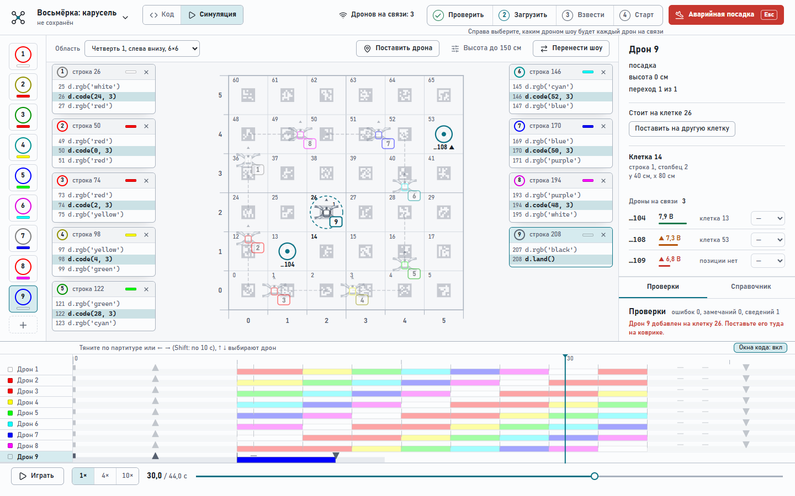
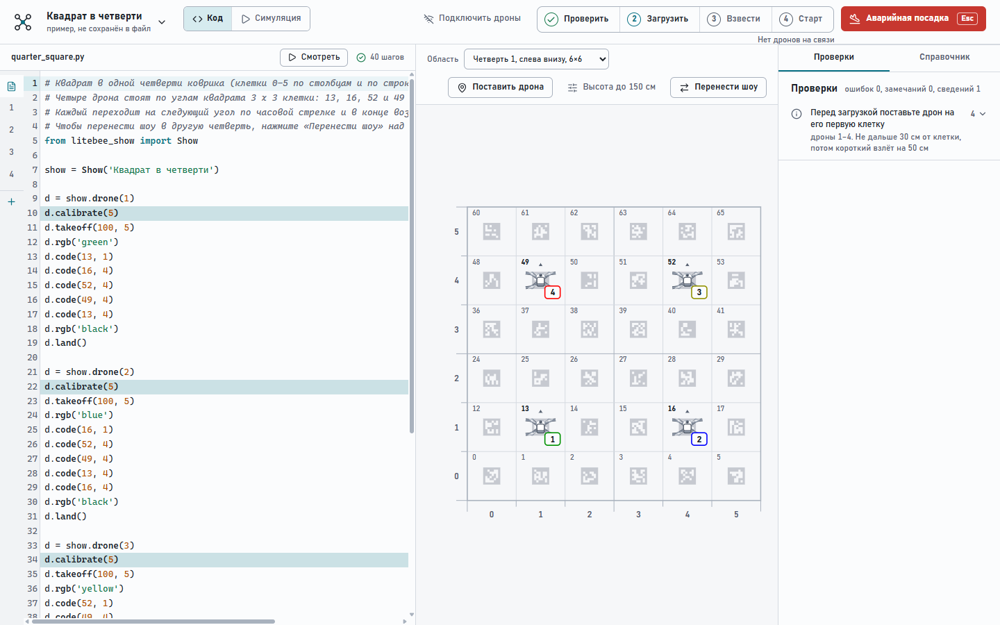
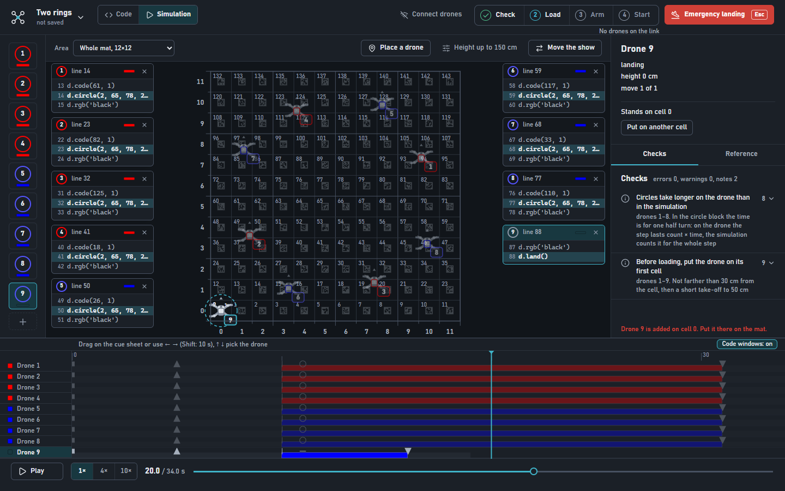

# Litebee IDE

[English](README.md) · **Русский**

Десктопная среда для программирования и полётов дронов **LiteBee Wing** (набор Makerfire FM-10). Шоу пишется на Python, его видно на карте классного коврика; приложение проверяет шоу, загружает его в дроны и запускает. Заменяет Scratch-часть LiteBee Go и импортирует его проекты `.lbg`.

Всё, кроме явных команд связи, работает без дронов: можно писать шоу, смотреть симуляцию и читать отчёт проверок.



## Что умеет

- **Карта коврика.** 12 × 12 клеток по 40 см, вид сверху. Номер клетки = столбец + 12 × строка. Дроны нарисованы по настоящему LiteBee Wing. Можно показать весь коврик или одну четверть (6 × 6 клеток, коврик сложен вчетверо).
- **Вкладки «Код» и «Симуляция».** В коде у каждого дрона своя вкладка. В симуляции карта, партитура света по времени и управление воспроизведением; партитура всегда открыта, а код каждого дрона всплывает над картой, пока листаете партитуру.
- **Проверить.** Запускает шоу и сообщает об ошибках, сближении дронов меньше 60 см, высоте выше лимита, скорости больше 100 см/с и шагах, которые нельзя загрузить.
- **Связь с настоящими дронами.** Заряд и позиция каждого дрона, роли по клетке, на которой он стоит, архив знакомых дронов. Порядок: Проверить, Загрузить, Взвести, Старт. Старт спрашивает подтверждение.
- **Аварийная посадка** всегда на виду (справа вверху, клавиша `Esc`).
- **Стартовые клетки.** У каждого дрона своя стартовая клетка. Перетащите дрона на карте на другую клетку или нажмите **«Поставить дрона»**, затем клетку; кнопка **«+»** добавляет ещё одного дрона в любой момент. Оба действия меняют код, поэтому `Ctrl+Z` их отменяет.
- **146 готовых шоу** на 2–10 дронов с разбивкой по числу дронов и мастер создания проекта с фильтрами.
- Интерфейс **на русском и английском**, светлая и тёмная тема.
- **Справочник** по каждой функции шоу: единицы, примеры и статус «проверено на дроне» или «только симулятор» (`F1`).





## Запуск

Windows, Node.js 20 или новее.

```bash
cd desktop
npm install
npm run dev        # разработка
npm run build      # сборка в desktop/out
npm test           # тесты (настоящих дронов они не трогают)
```

Код шоу выполняется на Python (Pyodide) внутри приложения, отдельный Python для работы не нужен. Тесты общаются с поддельным дроном на `127.0.0.1`, а не с настоящими портами 18001, 6000 и 13146.

## Как выглядит шоу

```python
from litebee_show import Show

show = Show('Квадрат в четверти')

d = show.drone(1)
d.calibrate(5)
d.takeoff(100, 5)
d.rgb('green')
d.code(13, 1)    # стартовая клетка
d.code(16, 4)    # лететь к клетке 16 за 4 секунды
d.rgb('black')
d.land()
```

Перед загрузкой каждый дрон стоит на клетке своего первого `d.code(...)`.

## Безопасность

- Приложение не заставит дрон лететь без явного действия: загрузка не раскручивает моторы, Старт просит подтверждение.
- Взлетайте со свежей батареей (старт запрещён ниже 7,0 В).
- Шагам по клеткам нужна позиция дрона: сделайте короткий взлёт заранее и не переносите дрон между загрузкой и стартом.
- Аварийная посадка: красная кнопка или `Esc`.

## Что в репозитории

| Путь | Что там |
| --- | --- |
| `desktop/` | приложение: Electron, React, TypeScript, Pyodide |
| `litebee/`, `app/` | Python-движок (модель шоу, протокол) и прежнее приложение на PySide6, оставлены как образец |
| `shows/` | примеры шоу, в `shows/gallery/` сгенерированные 146 |
| `tools/` | генераторы галереи, переводов и справочника |
| `docs/` | заметки о протоколе ([один дрон](docs/PROTOCOL_SINGLE.md), [шаги](docs/PROTOCOL_STEPS.md)), [устройство](docs/DESIGN.md), [заметки из руководства](docs/WING_MANUAL_NOTES.md) |
| `docs/uchebnik/` | учебник на русском (LaTeX, [PDF](docs/uchebnik/uchebnik.pdf)) |
| `PRODUCT.md` | зачем продукт и как он должен выглядеть |

## Состояние

На настоящих дронах летали все 10 дронов набора, включая `circle`. В классе шоу идут сразу на нескольких дронах; протокол описан в `docs/`.

*Фотографии настоящего дрона в репозитории пока нет: дрон на скриншотах нарисован приложением по ней. Чтобы добавить фото, сохраните его как `docs/images/drone.jpg` и вставьте `` под заголовком.*
